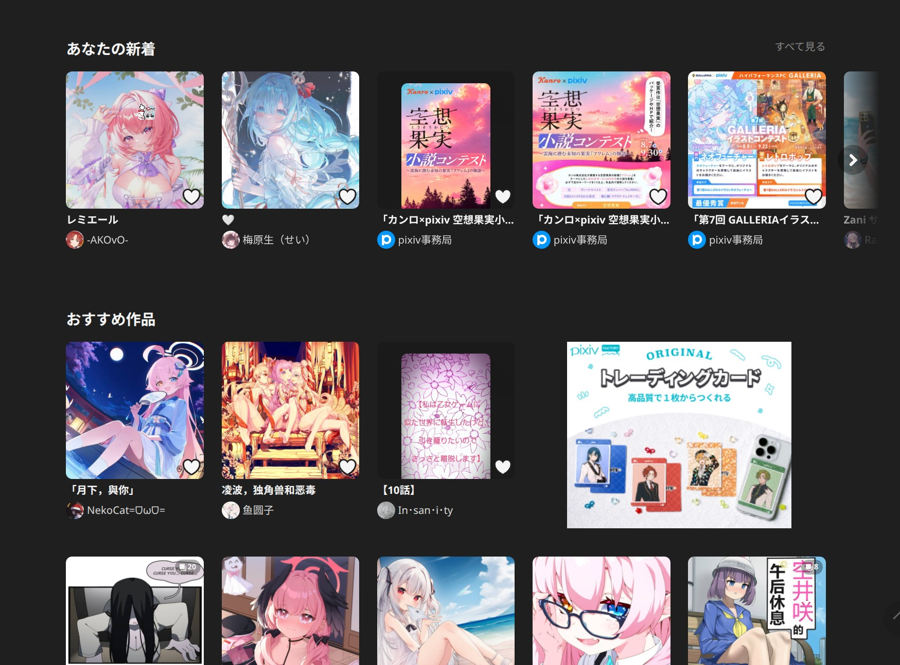
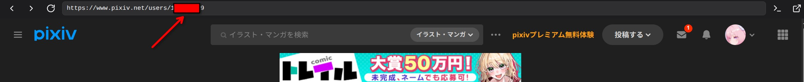

# Pixiv 크롤러 - 플러그인 안내

이 플러그인은 Pixiv에서 일러스트를 가져옵니다. 랭킹, 북마크, 작가 작품, 키워드 검색, 서드파티 API 다섯 가지 모드를 지원합니다.

## 로그인 상태

먼저 Kabegame의 서프 화면에서 `pixiv.net`을 여세요. 로그인한 사용자 계정으로 자동 크롤링됩니다.

### 사용자 ID 얻기 (본인 또는 작가)

서프 또는 브라우저에서 Pixiv 사용자 프로필을 엽니다.

URL 중간이나 끝에 있는 숫자 문자열(이미지의 빨간 상자)이 사용자 ID입니다.

### Cookie가 필요한 경우

| 모드 | Cookie |
|------|--------|
| 랭킹(비 R18) | 선택 |
| 랭킹(R18) | 필수 |
| 북마크 | 필수 |
| 작가 작품(비 R18) | 선택 |
| 작가 작품(R18) | 필수 |
| 키워드 검색(비 R18) | 선택 |
| 키워드 검색(R18) | 필수 |
| 서드파티 API(전연령) | 불필요 |
| 서드파티 API(R18/혼합) | 필수 |

## 크롤 타입

- **랭킹**: 순위·콘텐츠·연령; 단일 `ranking_date`(비우면 최신 기간)
- **북마크**: 공개 북마크 다운로드
- **작가 작품**: 지정 작가의 공개 작품 다운로드
- **키워드 검색**: 키워드로 검색 후 다운로드
- **서드파티 API**: 서드파티 API에서 작품 ID를 받아 ID별로 pixiv에서 상세와 원본을 다운로드(현재 Lolicon API)

## 설정 항목

선택한 모드에 따라 항목이 바뀝니다.

- **랭킹**: 유형·콘텐츠·연령(R18 시 UID·Cookie)·`ranking_date`. 다음 페이지는 JSON **`next`**
- **북마크**: 사용자 UID
- **작가**: 사용자 UID, 작가 UID
- **키워드**: 검색 키워드, 검색 모드(세이프/R18/전체), 정렬(날짜/인기). **잘 쓰면 원하는 것만 정확히 받을 수 있습니다**
- **서드파티 API**: API를 고르면 해당 API의 항목이 표시됩니다. Lolicon: 연령, 방향, 태그, 작가 UID, 작품 수, AI 제외, 투고 기간

## 최대 작품 수 (`num_artworks`)

**1～1000** 정수, **네 모드 모두** 사용. **작품(항목) 개수** 기준이며, **다페이지 작품**이면 저장 파일 수는 더 많을 수 있습니다.

스크립트는 **스트리밍**입니다. 목록 API를 **페이지마다** 요청하고, `illust_id`마다 곧바로 `ajax/illust/{id}/pages` 후 원본 다운로드. `num_artworks`에 도달하면 **중단**하며, 상한으로 페이지 수를 미리 계산해 목록만 먼저 긁지 않습니다(빈 페이지 **404** 방지).

### 동작 요약

1. **랭킹** `p=1`부터, **`next`**로 다음 페이지. `next`가 false면 종료. `num_artworks` 미달 시 **warn**.
2. **북마크** `limit=48`로 한 페이지 받고 그 페이지 작품을 **즉시** 다운로드. 상한 또는 끝까지.
3. **작가** `profile/all` **한 번**(목록 페이징 없음). 키 순서로 **받으면서** `num_artworks`에서 멈춤.
4. **키워드** 검색 `p=1,2,…`로 랭킹과 같이 스트리밍.

## 설정·실행 예시(스크립트가 실제로 하는 일)

Cookie·모드는 폼에 따릅니다. 날짜는 **`YYYYMMDD`**(하이픈 없음).

### 예 A: 랭킹(스트리밍·`next`)

| 항목 | 예 |
|------|-----|
| 소스 | 랭킹 |
| 유형 | 일간(`daily`) |
| 콘텐츠 | 전체(`all`) |
| 연령 | 전연령(`safe`) |
| 랭킹 날짜 | 비우거나 `YYYYMMDD` |
| 최대 작품 수 | `120` |

`ranking.php?...&format=json`를 `p=1`부터. 다음 페이지는 **`next`** 필드.

---

### 예 B: 북마크(페이지마다 즉시 다운로드)

| 항목 | 예 |
|------|-----|
| 소스 | 북마크 |
| 사용자 UID | 예: `12345678` |
| 최대 작품 수 | `50` |

`offset=0`, `limit=48`. `body.works[].id`를 **순서대로** `pages`까지 받고 **50** 작품에서 멈추거나 48 미만이면 다음 없음.

---

### 예 C: 작가(목록 1회, 다운로드만 상한)

| 항목 | 예 |
|------|-----|
| 소스 | 작가 작품 |
| 로그인 UID(`x-user-id`) | 본인 계정 UID |
| 작가 UID | 예: `87654321` |
| 최대 작품 수 | `5` |

`profile/all` 1회, `body.illusts` 키 순으로 **최대 5작품**(작품당 파일 여러 개 가능).

---

### 예 D: 키워드(검색 페이지 단위 스트리밍)

| 항목 | 예 |
|------|-----|
| 소스 | 키워드 |
| 키워드 | 예: `初音ミク` |
| 검색 모드 | 세이프(`safe`) |
| 정렬 | 날짜(`date_d`) |
| 최대 작품 수 | `25` |

`ajax/search/artworks/...`, `p=1,2,…`. `illustManga.data`를 **받으며** 다운로드. **25** 도달 또는 한 페이지 **60 미만**이면 종료.

---

네 가지 `source`를 다룹니다.**공통: 상한은 `num_artworks`. 페이징이 있는 모드는 스트리밍.**

## 서드파티 API 모드

서드파티 API는 작품 ID만 제공합니다. 상세·댓글·태그·**모든 페이지의 원본**은 다른 모드와 똑같이 pixiv에서 받으므로 pixiv에 접속할 수 있어야 합니다. 서드파티 API를 호출하는 동안에는 pixiv의 `Referer`·`Origin`·`Cookie`를 잠시 비우므로 pixiv 로그인 정보가 제3자에게 전송되지 않습니다.

### Lolicon API

[Lolicon API](https://docs.api.lolicon.app/#/setu)는 수록된 pixiv 작품을 **무작위로** 반환합니다. 페이지가 없어 작업당 한 번만 요청합니다.

| 항목 | API 파라미터 | 설명 |
|------|--------------|------|
| 연령 `lolicon_r18` | `r18` | 전연령/R18/혼합. Lolicon 자체 분류라 전연령에서도 pixiv에서 R-18 태그가 붙은 작품이 올 수 있어, 플러그인이 `R-18`/`R-18G` 태그 작품을 로컬에서 한 번 더 제외합니다. R18과 혼합은 서핑에서 pixiv 로그인이 필요 |
| 방향 `lolicon_orientation` | `aspectRatio` | 제한 없음/가로(`gt1`)/세로(`lt1`) |
| 태그 `lolicon_tags` | `tag` | 항목끼리는 AND(최대 3개), 한 항목 안에서 `\|`로 구분하면 OR(최대 20개). 태그·작가명·제목에 매칭. 예: `原神\|鸣潮` |
| 작가 UID `lolicon_uids` | `uid` | 최대 20개 |
| 작품 수 `lolicon_count` | `num` | 1~20. 조건이 좁으면 더 적게 오며 경고를 남깁니다 |
| AI 작품 제외 `lolicon_exclude_ai` | `excludeAI` | 기본 켜짐. pixiv가 AI로 명시한 작품만 제외 |
| 투고 기간 | `dateAfter`/`dateBefore` | pixiv 투고 시각(일본 시간) 기준 일 단위, 양 끝 포함 |

같은 작품의 다른 페이지는 하나의 작품으로 합쳐 모든 페이지를 받으므로 파일 수가 작품 수보다 많을 수 있습니다. Lolicon은 호출 빈도 제한이 있어, 제한되면 15초 기다린 뒤 최대 3번 재시도합니다.

## 주의사항

- 랭킹에서 `num_artworks`에 못 미치면 **warn**이 기록됩니다.
- 403이 나오면 cookie를 다시 받아보세요. 가끔만 나오면 rate limit일 수 있으니 작업을 몇 번 더 실행하거나, 서프 페이지에서 수동 다운로드하세요.
- Cookie 만료 후에는 다시 받아야 합니다.
- 키워드는 고급 검색 문법 지원 (예: `(Lucy OR 边缘行者) AND 5000users`)
- **인기순**은 Pixiv Premium이 필요합니다. Premium이 아니면 「날짜순」을 사용하세요.
- 최대 작품 수를 적당히 설정해 Pixiv 부하를 줄여주세요.
